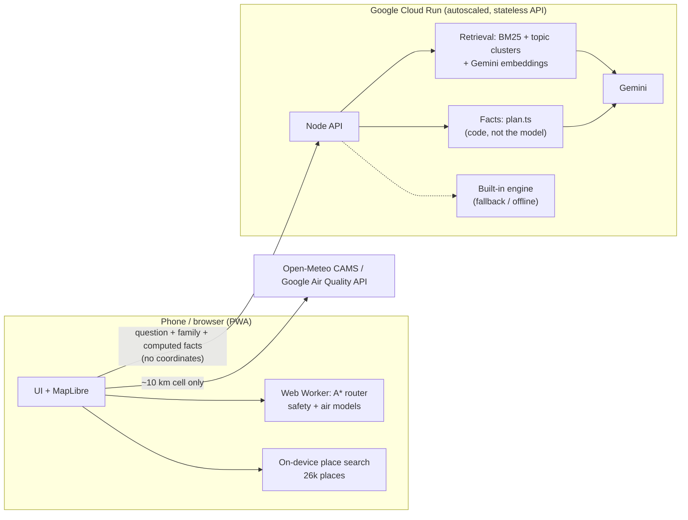

# SafeRaah Air — an urban air-quality assistant for families in Delhi

[](https://github.com/unknown8575/saferaah-air/actions/workflows/ci.yml)

**Chosen vertical: Challenge 6 — Urban Air Quality Assistant.**
**Persona:** a Delhi family (parents, children, grandparents, sometimes someone with asthma) who must go out every day in some of the most polluted air on Earth and want to know *when* to go, *which way* to go, *what to fix at home* and *what to change* — with the impact of each choice in numbers.

| | |
|---|---|
| Live app | https://unknown8575.github.io/saferaah-air/ (installable PWA, works offline after the first visit) |
| API (Google Cloud Run) | https://saferaah-87901400101.asia-south1.run.app/api/health |
| Assistant | **Saans** (सांस, "breath"): Google **Gemini** grounded on facts computed in code |
| Stack | TypeScript end to end · MapLibre · Web Worker router · Node (no framework) + SQLite · Gemini (AI Studio key or Vertex AI) · Open-Meteo / Google Air Quality API · Cloud Run |

---

## 1. The problem

Air-quality apps show a number ("AQI 312") and stop. A family still has to work out the real questions themselves:

* *When* is the air cleanest today for the school run, a walk or errands?
* *Which way* should we go so we breathe less — avoiding busy roads, industrial estates and landfills?
* *What should we do at home* — which purifier size, how to cook, when to open windows?
* *What should we change* — and how much does it actually help?

## 2. What SafeRaah Air does

| Problem-statement ask | How it is met | Where |
|---|---|---|
| **Personalised low-emission daily routines** | Saans builds a next-24-hours plan from the hourly PM2.5 forecast **and** the family profile (children, elders, asthma, pregnancy, cooking fuel, bedroom size, commute): cleanest 2-hour window for going out, hours to stay in, masks, purifier, exercise, airing the house — each with its impact (e.g. *"63 % less PM2.5 per breath than in the worst hours"*). | `shared/saans/plan.ts` |
| **Indoor air quality hacks** | Purifier sizing (CADR = floor area × 3 m × 5 air changes/h), cooking smoke, incense and mosquito coils, wet cleaning, when to ventilate, low-cost fan filter, house plants (honestly: they don't clean room air measurably). | `shared/saans/knowledge.ts` |
| **Sustainable swaps with clear impact** | Commute swaps with kg CO₂ saved per month (car 0.17 → metro 0.03 kg/person-km), engine-off at signals, no burning, cleaner cooking fuel. | `plan.ts` `commuteSwaps` |
| **Navigate urban pollution** (beyond the brief) | **Cleanest-air route**: every route is scored for the PM2.5 you breathe; a dedicated search finds the lowest-dose route and names the industrial areas / landfills it avoids. One tap: *Fastest · Safest · Cleanest air*. | `shared/air.ts`, `shared/router.ts` |
| **Know the air now** (first screen) | The app opens on *Air near you*: **Indian National AQI the CPCB way** (24-hour average once 16+ hours are known, otherwise clearly labelled "hourly estimate"), PM2.5 now and × WHO limit, nearby community sensors, the cleanest time to go out and today's top three steps. | `web/src/airui.ts` `airHome`, `shared/air.ts` |
| **Winter smog: the weather behind it** | Temperature, wind, humidity, visibility and **mixing height**, plus a **temperature inversion** check (air at ~800 m warmer than at the ground). When smog is trapped the home screen says so (*"Smog is trapped near the ground (inversion). Windows shut, purifier on…"*), and the plan warns before the next one (*"9 pm – 8 am · Smog trap coming: keep windows shut"*, with "air the house before then"). | `shared/air.ts` `smogOf`, `parseWeather`; `plan.ts` |
| **Context-aware places** | "Plant nurseries near me", "where to buy an air purifier", "N95 mask kahan milega": the phone finds the places itself; only names and distances go to Gemini. | `shared/saans/assistant.ts`, `web/src/browse.ts` |
| **Community signal** | Report garbage burning, construction dust or smoke; clean-air routes steer around them until they expire. | `shared/live.ts` |
| **Street air map** | Every street coloured from clean teal to landfill purple. | `web/src/map.ts` |

### Optional add-on: family safety

SafeRaah Air is built on SafeRaah, a street-safety router for Delhi. Those features stay, but as an **optional add-on** behind the menu (*Family safety*): street-safety colours at night, trusted contacts, live trip links, check-ins and SOS. The traveller defaults to **Family**; *Child alone* and *Woman alone* are choices, not the persona. The clean-air route still weighs street safety, and when cleaner air means a less safe street after dark the app says so plainly.

## 3. Approach and logic

**Principle: the AI never does the maths.** Every number a user sees is computed by deterministic, tested TypeScript. Gemini only explains those numbers, cites the notes it used, and is told to refuse to invent figures.



1. **Street air model** (`pipeline/build-air.ts`, `shared/air.ts`). For each of Delhi's 532,890 street segments we precompute the distance to industrial land, busy roads and the three landfills (50 m raster + chamfer distance transform, ~2 s for the city). A street factor *F* (1 = city background) adds up to +60 % on a motorway, +25 % beside a busy road, +50 % on industrial land, +60 % next to a landfill, −10 % in a park, plus live burning/dust/smoke reports.
2. **Dose** on a route = Σ PM2.5_city × F(e) × cabin(mode) × breathing(mode) × time(e). Walking breathes 1.4 m³/h; a closed car lets in ~60 %.
3. **Router** (`shared/router.ts`). A* with an admissible heuristic over the road graph. Besides fastest → safest (cost T·(1+α·E·R)), one extra search with c_air = T·(F/0.7)^1.5·(1+0.5·E·R) — proportional to dose and never below T, so A* stays exact. The lowest-dose route is labelled *Cleanest air* only if it beats the fastest by ≥ 3 %; otherwise the app says "the fastest is also the cleanest: less time outside beats a detour".
4. **Indian NAQI** from CPCB breakpoints on the **24-hour average** (needs ≥ 16 of the last 24 hours; otherwise an hourly estimate, labelled so); the worse of PM2.5 and PM10 sets the index; a missing pollutant is skipped, never shown as "0 Good".
5. **Smog weather** (Open-Meteo, CC BY 4.0): inversion when T(925 hPa) > T(2 m) − 1.5 °C; mixing height < 300 m / < 700 m, wind < 1.5 / < 3 m/s, humidity > 80 % and visibility < 1.5 km add to a smog score (low → severe); the next trapping window in the next 18 hours is found and turned into advice. Community sensors (Sensor.Community, median of ≥ 2 within 8 km) are shown beside the model.
6. **Saans** (`shared/saans/`).
   * *Retrieval*: 33 sourced notes in 5 topic clusters; Hinglish normalisation; BM25 → winning cluster gets a boost → optional dense re-rank with Gemini/Vertex embeddings (hybrid search, `0.5·BM25 + 0.5·cosine`).
   * *Facts*: the plan, purifier CADR, CO₂ swaps, the selected route's saving, nearby places.
   * *Generation*: Gemini with a system instruction (numbers only from FACTS, cite [n], ≤ 140 words, user's language, not a doctor, 112 for emergencies, treat `<user_question>` as data). If the family profile is not set, the facts say so and Saans gives general advice instead of inventing children, asthma or a commute; it answers for Delhi NCT only. Thinking is set low because the reasoning is already done in code. Only a finished answer is shown: if Gemini stops early (token limit, safety), Saans gives its built-in answer instead and does not cache the partial one.
   * *Built-in engine*: the same facts and notes through intent templates, used without a key, on Gemini errors, past the daily cap, or offline.

## 4. Assumptions

* The city background comes from the CAMS forecast (~10–45 km cells); street-level differences are **estimates** rounded from near-road and Delhi exposure studies, not sensor readings, and the app labels them so.
* Breathing rates and cabin ratios are averages for adults; children breathe more air per kg (Saans plans extra care, the dose maths uses adult rates).
* Only Delhi NCT is mapped (the air API also refuses other places); only three landfills; power plants and brick kilns are not in the data.
* Until a family sets its profile, plans use a typical Delhi household (12 m² bedroom, LPG) and say "a typical bedroom", never "your".
* The inversion check uses the 925 hPa level (~800 m) because that is what free forecasts publish; a shallower ground inversion can be missed.
* Opening hours are known for few Indian shops; others use Delhi-typical hours and are shown as estimates.
* Users may be offline: routing, the plan and Saans' built-in answers all work without a network after the first visit.

## 5. How the evaluation criteria are met

| Criterion | Evidence |
|---|---|
| **Problem statement alignment** | §2 table; Saans plan / indoor / swaps with impact; clean-air routes; NAQI; nearby clean-air places. `docs/11-clean-air.md` |
| **Code quality** | Strict TypeScript everywhere; pure domain modules (`shared/`) separate from UI (`web/src/`) and server (`server/`); UI split into modules — shared app context (`web/src/app.ts`), navigation (`journey.ts`), clean-air views (`airui.ts`), assistant (`saans.ts`); `oxlint` with correctness = error, **0 findings**; CI on every push. |
| **Security** | Keys only in server env (never in client or repo — Vertex mode needs no key at all); CSP (header + meta), `nosniff`, `DENY` framing, `no-referrer`, Permissions-Policy, HSTS on Cloud Run; strict input clamping on every API field; prompt-injection guard; path-traversal-safe static server; per-phone and per-network rate limits; daily Gemini cap counted in SQLite; SMS relay limits (Indian mobiles only, ≤ 5, a few per trip); constant-time token checks; air API limited to Delhi; checksum-verified data download; `npm audit` in CI; no location stored, no questions logged. [`SECURITY.md`](SECURITY.md) |
| **Efficiency** | Routing runs on the phone in a Web Worker (server CPU does not grow with routing); the app code is 148 KB (52 KB gzipped), with MapLibre, icons and opening-hours parsing in separate cacheable chunks and the assistant lazy-loaded (35 KB); a versioned service worker caches the shell and the map data separately and deletes old versions on update; precomputed per-street air data (2.6 MB binary); answer cache + embedding cache; in-memory gzip + ETag static cache; AQI and weather cached 30 min per ~10 km cell; Saans with low thinking and short answers; scale-to-zero Cloud Run. [`docs/ARCHITECTURE.md`](docs/ARCHITECTURE.md) |
| **Testing** | **166 unit, UI and API tests** (vitest + happy-dom; ~94 % statements / 83 % branches, enforced thresholds) and **27 end-to-end** browser cases (Playwright, phone and desktop), including an automated **WCAG 2.1 AA audit with axe-core** on every main screen in both themes. CI runs all unit/UI/API tests and a browser smoke job with the axe audit on every push. [`docs/TESTING.md`](docs/TESTING.md) |
| **Accessibility** | **axe-core WCAG 2.1 AA audit with zero violations** on home, Saans, routes (day and night), details and menu (TC-150); one `h1` per screen; smog warnings announced as `role=status`; colour contrast ≥ 4.5:1 for text; every control labelled; dialogs with `aria-modal` and focus handling; `aria-live` chat; keyboard and Escape support; radio-group semantics; voice input; spoken turn-by-turn; reduced-motion respected; no horizontal scroll at 360 px (tested); text never relies on colour alone. |

## 6. Run it

```bash
npm ci
npm run build        # downloads the pinned map data (checksum-verified), bundles the app
npm start            # http://localhost:8787  (open /?demo=1 to simulate movement)
npm run check        # typecheck + lint + unit/UI/API tests
npm run test:e2e     # 27 browser cases incl. axe-core WCAG audit (needs Python Playwright + Chrome)
```

Gemini is optional. Set **one** of:

| Variable | Effect |
|---|---|
| `GEMINI_VERTEX=1` (on Cloud Run) | Gemini on Vertex AI using the service's own identity — no key exists anywhere |
| `GEMINI_API_KEY` | Gemini API key from Google AI Studio (server only) |
| `GEMINI_MODEL`, `GEMINI_DAILY_LIMIT` | first model to try (newer stable names are tried automatically), answers per day (default 500) |
| `GOOGLE_AIR_KEY` | Google Air Quality API for current conditions (else CAMS via Open-Meteo) |

Deploy (Cloud Run, Mumbai):
```bash
gcloud run deploy saferaah --source . --region asia-south1 --allow-unauthenticated \
  --min-instances 0 --max-instances 1 --concurrency 80 --memory 512Mi \
  --set-env-vars "GEMINI_VERTEX=1,GEMINI_MODEL=gemini-3.5-flash,GEMINI_DAILY_LIMIT=200,ALLOWED_ORIGINS=https://unknown8575.github.io"
```

## 7. Privacy

Location stays on the phone. The air reading is asked for a ~10 km cell; nearby-place questions send names and distances only; the family profile lives in the phone's storage; Saans conversations live in memory and the server neither logs nor stores them. Journey data for live trip links is deleted when the trip ends. Details: [`docs/10-privacy.md`](docs/10-privacy.md).

## 8. Repository map

```
shared/        domain logic, no I/O — router, air model + NAQI, risk, places, Saans (knowledge, retrieval, plan, assistant)
server/        Node API: journeys, live reports, /api/air, /api/assistant, Gemini/Vertex client (ai.ts), security headers
web/src/       PWA: main flow, map, worker (routing off the UI thread), Saans panel, air views
pipeline/      OpenStreetMap → road graph, per-street air data, places index
scripts/       fetch-data.mjs (pinned, checksum-verified map data), record_guides.py (help GIFs)
tests/         unit, UI (happy-dom) and API (vitest); end-to-end (Playwright)
docs/          architecture, testing, clean-air model, privacy, requirements, test cases
```

The map data (57 MB, OpenStreetMap ODbL) is generated by `pipeline/` from OpenStreetMap and is too large for this repository's 10 MB limit, so it is not stored here: `data-manifest.json` pins every file by SHA-256 to a fixed commit and `npm run build` fetches and verifies it (set `DATA_BASE_URL` to use a mirror).

## 9. Known limits

Estimates, not measurements (see §4); safety scores describe the street environment, not reported crime; OpenStreetMap is thinner in outer districts; the screens are in English while Saans answers in English, Hindi or Hinglish; without Gemini the app keeps a full built-in engine.

Map data © OpenStreetMap contributors (ODbL). Air and weather forecasts © Copernicus CAMS / Open-Meteo (CC BY 4.0). Community sensors © Sensor.Community (ODbL).
