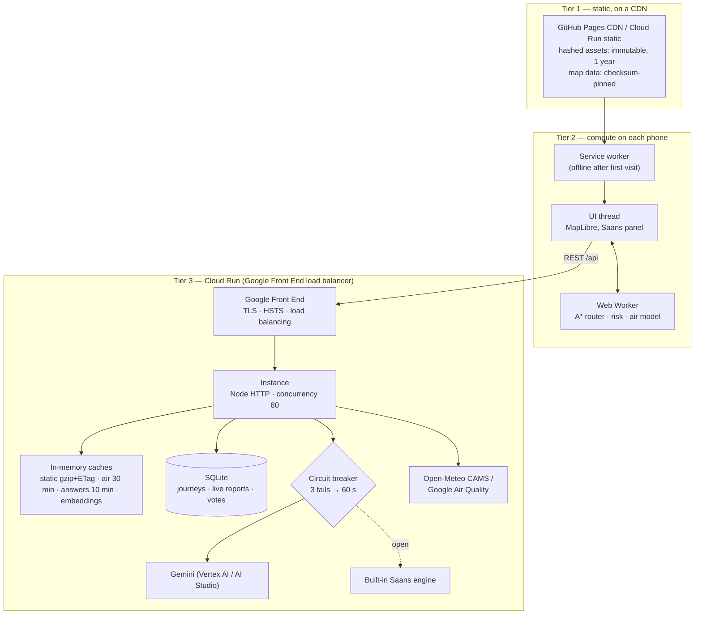

# Architecture and system design

SafeRaah Air is split into three tiers so that the expensive work scales with the number of users **for free**, and the only shared server stays small, stateless where it matters, and protected.

## Why this shape

| Decision | Effect |
|---|---|
| **Routing on the device** (Web Worker, 25 MB graph cached by the service worker) | The heaviest computation (A* over 533k edges, 5 searches per request, 0.1–0.7 s) never touches the server. 1 user or 1 million users cost the server the same for routing: this is horizontal scaling by design, on hardware the users already own. Works offline. |
| **Precomputed street data** (`graph.bin`, `air.bin`, typed arrays) | No per-request geometry: the air factor of every street is one array lookup. Building it for the whole city takes ~2 s (raster + chamfer distance transform). |
| **Static tier on a CDN** | The app shell and data are cache-friendly: hashed bundles are `immutable`, map data `max-age=86400`; the node server keeps gzip copies and ETags in memory (304 on repeat). Bundles are split so a release only re-downloads what changed: app 155 KB, MapLibre 1.08 MB, icons, opening hours, Capacitor, and Saans (lazy). |
| **Versioned offline cache** | The service worker keeps two caches named by build hash and data-manifest hash: the shell (cache-first for hashed `/assets/`) and the map data (cache-first). The install step caches only the small shell; the files the first visit already downloaded (including the routing worker's road graph) are copied in from the HTTP cache, so the 25 MB graph is never downloaded twice. Old versions are deleted on activate. |
| **Stateless AI and air endpoints** | `/api/assistant` and `/api/air` keep no session; any instance can answer any request, so they scale horizontally behind Google's load balancer. |
| **Thin facts → model** | Gemini receives a ~1.5 KB prompt of computed facts and 3–4 notes, not raw data; answers are short (≤ 140 words). Lower latency and cost. |

## Scaling

* **Vertical (per instance):** one Node process handles up to 80 concurrent requests (`--concurrency 80`); everything slow is I/O (Gemini, air API), so CPU stays low. Memory: 512 MiB is enough for the static cache (capped at 160 MB) and SQLite.
* **Horizontal:** Cloud Run adds instances automatically behind the Google Front End load balancer and scales to zero when idle. The stateless endpoints (static, `/api/air`, `/api/assistant`, `/api/health`) can run on any number of instances today.
* **Why `--max-instances 1` for now:** journeys (live trip links, SOS) and live reports live in SQLite on the instance. With two instances a family member could poll an instance that never saw the trip. Until that state moves to a shared store, one instance with high concurrency is the correct, consistent choice.
* **Path to many instances** (no change to the client or the domain code):
  1. journeys, reports, votes → Firestore or Cloud SQL (the SQL is already isolated in `server/routes/*` / `server/db.ts`);
  2. rate limits and the answer cache → Memorystore (Redis), so limits hold across instances;
  3. then raise `--max-instances`; the load balancer spreads traffic, and `/api/health` serves as the readiness check.

## Resilience

| Failure | Behaviour |
|---|---|
| Gemini slow / down / quota | 25 s timeout, one retry on 429, unknown or forbidden model names skipped to the next stable model, **circuit breaker** (3 failures → 60 s pause), then the built-in engine answers with the same facts; the UI says which engine answered and why. |
| Air API down | 8 s timeout; Google Air Quality → CAMS fallback; the app shows "checking" and Saans gives general advice. |
| No network | Service worker serves the app and data; routing, the day plan and built-in Saans work offline. |
| Instance replaced | Cloud Run sends SIGTERM → the server stops accepting, finishes in-flight requests, closes the database (`server/main.ts`). |
| Abuse | Per-phone and per-network limits, daily Gemini cap counted in SQLite (per instance; moves to the shared store with the rest of the state), SMS relay caps, 512 KB body cap, input clamping. |

## Data flow for one Saans question

1. The phone finds nearby places (if asked) and the selected route's numbers; it sends the question, family profile, rounded air reading and those numbers — no coordinates.
2. The server sanitises and clamps every field, checks limits and the answer cache.
3. Retrieval: BM25 + topic cluster boost (+ Gemini embeddings when available).
4. `plan.ts` computes all facts; `buildPrompt` assembles FACTS + numbered NOTES + the question in `<user_question>` tags.
5. Gemini writes; the server tidies the text and returns it with the note list; on any failure the built-in engine answers.

## Module boundaries

* `shared/` — pure domain logic, no I/O, used by the worker, the server and the tests. The router is a pipeline of small steps (`router.ts`) over an A* module (`astar.ts`) and a route scorer (`describe.ts`).
* `server/` — HTTP, storage, Google clients; depends on `shared/` only. `app.ts` only dispatches; each group of endpoints is a module in `server/routes/`, every request body is checked in `validate.ts` (bodies arrive as `unknown`), limits and headers live in `http.ts`.
* `web/src/` — UI, one module per screen (home, search bar, directions, routes, details, journey, Saans…) sharing one typed state object (`S` in `app.ts`); views such as `airui.ts` are pure renderers with unit tests. The page and the routing worker talk through typed messages (`worker-api.ts`).
* `pipeline/` — offline data build from OpenStreetMap.

### Enforced limits

`oxlint` fails CI on any TypeScript file over 500 lines (blank lines and comments not counted), any function over 80 lines, cyclomatic complexity over 20, nesting deeper than 4, more than 8 parameters, or an explicit `any` (tests excepted for the size rules). TypeScript runs with `strict`, `noUnusedLocals`, `noUnusedParameters` and `noFallthroughCasesInSwitch`; Prettier formatting is checked.
